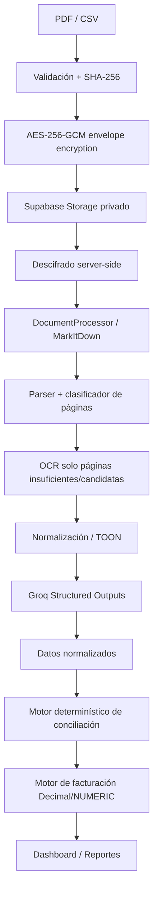

# Sistema de Conciliación de Albaranes y Facturación

Aplicación Next.js + Supabase para conciliar soportes PDF con unidades despachadas en CSV. La extracción documental puede usar MarkItDown y OCR selectivo, mientras que la conciliación, devoluciones y facturación se resuelven de forma determinística.

## Arquitectura



### Decisiones principales

- **Next.js App Router / Node runtime** para UI, Auth y endpoints de dominio.
- **Supabase Auth + RLS**: `viewer` puede leer resultados; `admin` realiza escrituras sensibles.
- **Storage privado** y **cifrado a nivel de aplicación** mediante clave de datos aleatoria por archivo y una clave maestra de 32 bytes solo servidor.
- **DocumentProcessor desacoplado**. `workers/python` contiene una implementación FastAPI/Docker con MarkItDown, PyMuPDF y Tesseract. Esto evita introducir un paquete Python pesado dentro de la función serverless de Next.js y permite migrar a Railway, Fly.io, Cloud Run, Render, ECS u otro worker sin alterar el dominio.
- **Groq no calcula facturas**. Solo interviene cuando la estructura documental es ambigua. Los dos GPT-OSS configurados admiten Structured Outputs `json_schema` estricto.
- **CSV real**: delimitador `;`, BOM UTF-8, UTF-8 y fallback Windows-1252/Latin-1. Cada fila se trata como una unidad.
- **TOON** se aplica en `lib/ai/toon.ts` antes de Groq y registra reducción de caracteres y estimación de tokens.

## Estructura

```text
app/                     Next.js App Router
components/              UI compartida
lib/
  ai/                    Groq + TOON
  auth/                  guardas de sesión
  billing/               cálculo monetario determinístico
  crypto/                AES-256-GCM envelope encryption
  csv/                   parser y normalización
  documents/             DocumentProcessor y parser de albaranes
  reconciliation/        motor de conciliación
  security/              validación de upload
  supabase/              clientes server
supabase/
  migrations/            esquema, índices, RLS, storage policies
  seed.sql                catálogo inicial sin precios
workers/python/           MarkItDown + OCR selectivo
 tests/                   Vitest + Playwright + fixture 143909
.github/workflows/        CI
```

## Variables de entorno

Copiar `.env.example` a `.env.local`.

- `NEXT_PUBLIC_SUPABASE_URL`: URL pública del proyecto Supabase.
- `NEXT_PUBLIC_SUPABASE_ANON_KEY`: anon key pública; protegida por RLS.
- `SUPABASE_SERVICE_ROLE_KEY`: solo servidor. No se utiliza desde navegador.
- `GROQ_API_KEY`: secreto servidor.
- `GROQ_PRIMARY_MODEL=openai/gpt-oss-120b`.
- `GROQ_FAST_MODEL=openai/gpt-oss-20b`.
- `FILE_ENCRYPTION_KEY`: **32 bytes aleatorios codificados Base64**.
- `APP_URL`: URL local o de Vercel.
- `MAX_UPLOAD_MB`: límite de archivos (máximo efectivo de 4 MB por el límite de peticiones de Vercel Functions).
- `DOCUMENT_PROCESSOR_URL`: URL interna/privada del worker Python.
- `DOCUMENT_PROCESSOR_TOKEN`: secreto compartido con el worker.

Generar la clave de cifrado:

```bash
openssl rand -base64 32
```

No rotar esta clave sin un procedimiento de re-wrapping de `encrypted_file_key`; de lo contrario los archivos existentes no se podrán descifrar.

## Supabase

1. Crear un proyecto.
2. Instalar Supabase CLI.
3. Enlazar el proyecto: `supabase link --project-ref <ref>`.
4. Ejecutar `supabase db push`.
5. Ejecutar `supabase db seed` o aplicar `supabase/seed.sql`.
6. Confirmar que `documents-encrypted` y `generated-reports` aparecen como **Private**.

### Primer administrador

Crear primero el usuario mediante Supabase Auth (Dashboard o Admin API). Después, desde SQL Editor con privilegios administrativos:

```sql
insert into public.profiles(id,email,full_name,role,active)
select id,email,'Administrador inicial','admin',true
from auth.users
where email='admin@ejemplo.com'
on conflict(id) do update set role='admin',active=true;
```

No se ofrece una ruta pública para auto-asignar `admin`.

## RLS

Todas las tablas sensibles tienen RLS. Las políticas usan `is_active_user()` o `is_admin()`; no existe `USING (true)` en tablas de dominio. Un viewer no puede insertar, actualizar ni borrar períodos, documentos, registros, conciliaciones, precios, usuarios o auditoría a través de la API normal.

Para verificarlo en staging, autenticar un usuario `viewer` y ejecutar un `insert` contra `billing_periods`: Supabase debe responder con violación de RLS.

## Procesador documental / MarkItDown

El worker acepta **solo rutas locales** ya validadas por la aplicación. No recibe URLs arbitrarias. Valida `%PDF-` y SHA-256. Por página:

1. Extrae texto nativo con PyMuPDF.
2. Clasifica la página.
3. Si el texto es insuficiente y parece `DESPACHO/Albarán`, ejecuta Tesseract únicamente sobre esa página.
4. Genera un PDF temporal de **una sola página** y llama `MarkItDown.convert_local()`.
5. El archivo temporal se elimina en `finally`.

Construcción local:

```bash
cd workers/python
docker build -t albaranes-document-processor .
docker run --rm -p 8787:8787 \
  -e DOCUMENT_PROCESSOR_TOKEN=secreto \
  albaranes-document-processor
```

En producción, se recomienda desplegar este worker separado de Vercel y restringir su acceso mediante secreto y red cuando el proveedor lo permita.

## Groq

`lib/ai/groq.ts` utiliza Structured Outputs `json_schema` en modo estricto. El prompt prohíbe cálculos contables e invención. La aplicación debe persistir métricas en `ai_runs` al integrar el job orchestration completo.

La estrategia es: parser determinístico → regex/tablas → MarkItDown → Groq únicamente para ambigüedad.

## Conciliación

`lib/reconciliation/engine.ts` compara principalmente:

`albarán + component_code + unit_number`

Y valida adicionalmente fecha/confianza. Estados implementados en el dominio: `MATCH`, `PDF_ONLY`, `CSV_ONLY`, `DATE_MISMATCH`, `RETURNED`, `REVIEW_REQUIRED` y enum SQL completo para los estados restantes.

El fixture `tests/fixtures/143909.csv` contiene 27 unidades anonimizadas:

- GRPL: 17
- PFC: 6
- PFCF: 4
- Total: 27

El test no codifica el total conciliado directamente en el motor: genera el lado PDF a partir de los registros normalizados y valida que el algoritmo produzca 100%.

## Facturación

`lib/billing/engine.ts` usa `decimal.js`; PostgreSQL utiliza `numeric(18,2)`. Solo se facturan ítems en estado `MATCH`. Las devoluciones y diferencias quedan excluidas hasta revisión. El seed no inventa precios.

## Desarrollo local

```bash
npm install
cp .env.example .env.local
npm run dev
```

Verificación obligatoria:

```bash
npm run lint
npm run typecheck
npm test
npm run build
```

E2E (requiere variables Supabase válidas):

```bash
npx playwright install chromium
npm run test:e2e
```

## GitHub

```bash
git init
git add .
git commit -m "feat: sistema de conciliación de albaranes"
git branch -M main
git remote add origin <URL_REPOSITORIO>
git push -u origin main
```

GitHub Actions ejecuta lint, typecheck, Vitest y build. No guardar `.env.local` ni secretos.

## Vercel

1. Importar el repositorio GitHub.
2. Agregar todas las variables de `.env.example` en Project Settings → Environment Variables.
3. Definir `APP_URL` con el dominio de producción.
4. No desplegar el worker Python pesado dentro del bundle Next.js; usar `DOCUMENT_PROCESSOR_URL` hacia el worker separado.
5. Desplegar. Vercel ejecutará `npm run build`.

## Seguridad operacional

- No hay buckets públicos ni signed URLs permanentes.
- El endpoint de descarga/streaming definitivo debe recuperar el blob cifrado, verificar rol, descifrar y responder sin persistir la copia plaintext.
- Los nombres de Storage usan UUID, no el nombre original.
- No se aceptan URLs de usuario para MarkItDown.
- CSP, `nosniff`, frame denial, referrer policy y permissions policy se aplican desde `next.config.ts`.
- No registrar claves, cookies, tokens o plaintext de documentos en logs.
- Para alto volumen, mover `pending → extracting → analyzing → reconciling` a una cola y worker duradero.

## Limitaciones conocidas de esta entrega

- El PDF `FRA 3282-HOSPITAL DE ALTA COMPLEJIDAD.pdf` y el CSV `UnitsSentToOtherCentres.csv` **no estaban adjuntos en el mensaje que originó este repositorio**, por lo que no se afirma que el parser haya sido validado contra esos binarios reales. Se incluye un fixture anonimizado conforme a los conteos indicados para 143909.
- Las pantallas administrativas están creadas como módulos base; para una operación final se deben conectar las tablas a formularios CRUD, paginación, filtros, exportadores XLSX/PDF y el flujo de revisión manual.
- El job orchestration completo de procesamiento asíncrono y el endpoint autenticado de streaming de páginas originales requieren el almacenamiento Supabase real para una prueba end-to-end.
- Tesseract español se instala en el Docker del worker; documentos manuscritos pueden requerir un motor de visión adicional. La arquitectura deja esa decisión detrás de `DocumentProcessor`.

## Licencia

Uso privado/interno. Añada una licencia pública únicamente si realmente desea distribuir el código bajo esos términos.
